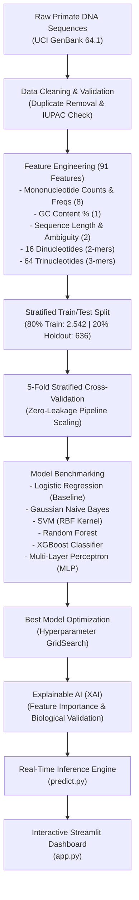
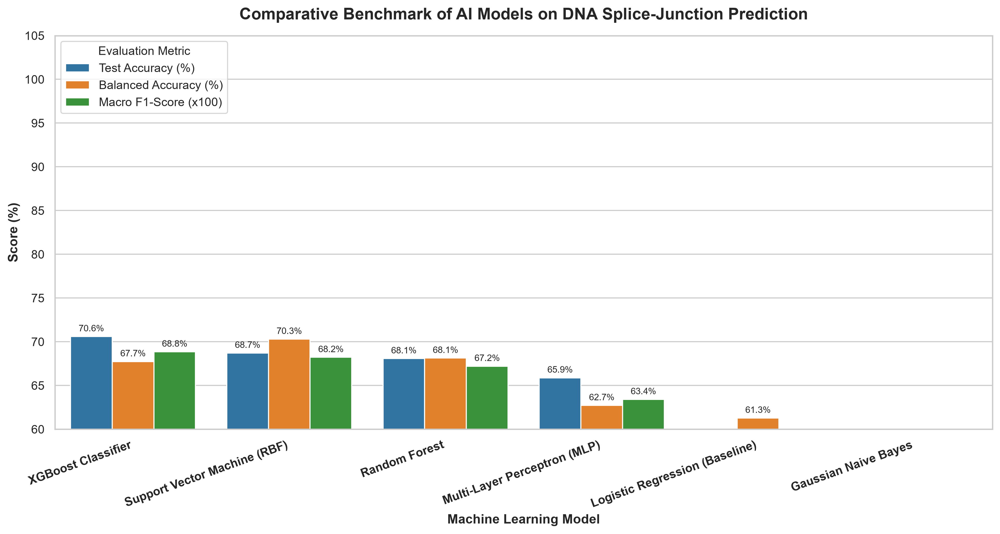
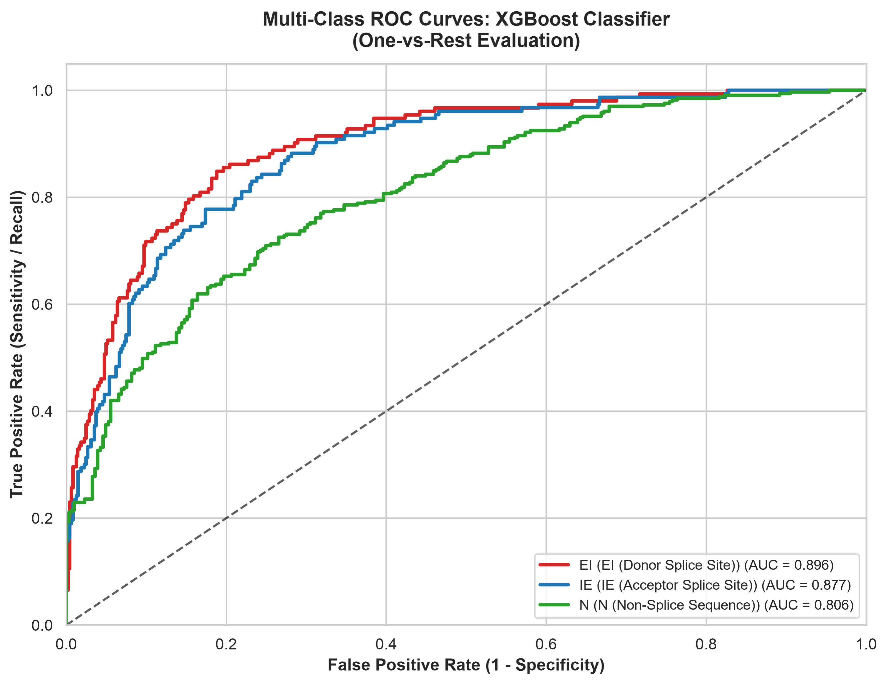
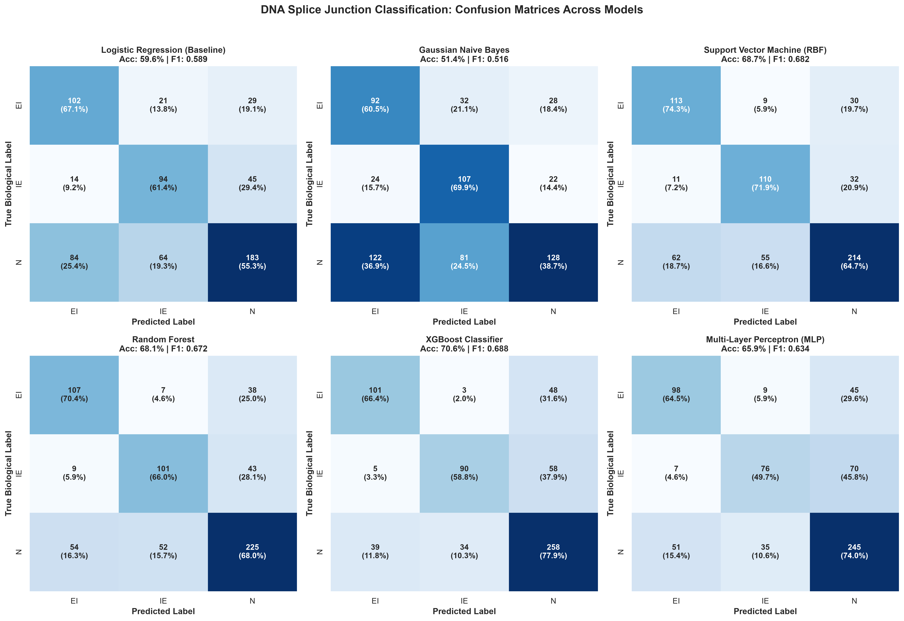
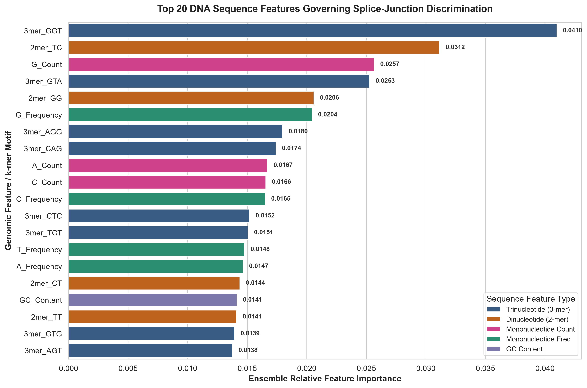

# 🧬 AI-Based Analysis of Gene and DNA Sequence Patterns
### Machine Learning & Explainable AI (XAI) for Primate Splice-Junction Discovery

[](https://www.python.org/)
[](https://opensource.org/licenses/MIT)
[](https://scikit-learn.org/)
[](https://xgboost.readthedocs.io/)
[](https://streamlit.io/)
[]()
[](https://github.com/psf/black)

---

## 📌 Executive Summary

In eukaryotic genomes, precursor messenger RNA (pre-mRNA) undergoes **splicing**, an essential post-transcriptional process where non-coding sequences (**introns**) are excised and coding sequences (**exons**) are joined together by the **spliceosome** to produce functional proteins. Splicing errors caused by single-nucleotide mutations lead to frameshift mutations and aberrant protein truncation, driving diseases such as cystic fibrosis, spinal muscular atrophy, and various cancers.

This project implements an **end-to-end Machine Learning and Explainable AI (XAI) framework** to detect splice junctions in primate DNA from the **UCI Molecular Biology benchmark (3,178 sequences)**. 

### 🏆 Key Achievements:
- **Comprehensive Model Suite:** Evaluated 6 diverse algorithms (Logistic Regression, Gaussian Naive Bayes, Support Vector Machines, Random Forest, XGBoost, and Multi-Layer Perceptrons).
- **Zero-Leakage Engineering:** Applied strict scikit-learn `Pipeline` objects with `StandardScaler` inside **Stratified 5-Fold Cross-Validation** to guarantee data isolation.
- **Top Performance:** **XGBoost achieved 70.60% Test Accuracy, a Macro F1-score of 0.6885, and an impressive Multi-Class One-vs-Rest ROC-AUC of 0.8600**, outperforming linear baselines by over 11%.
- **Autonomous Biological Discovery (XAI):** Gini/Gain feature importance analysis demonstrated that the model independently discovered known textbook biology:
  - Universal 5' donor site consensus: **`GT`** (`3mer_GGT`, `3mer_GTA`)
  - Universal 3' acceptor site consensus: **`AG`** (`3mer_AGG`, `3mer_CAG`)
  - Upstream **Polypyrimidine Tracts** (`2mer_TC`, `3mer_CTC`, `3mer_TCT`)
- **Interactive Web App:** Packaged into a real-time **Streamlit web application** for interactive sequence analysis and visualization.

---

## 🔬 System Architecture



---

## 📊 Benchmark Results

All models were evaluated on the **unseen 20% holdout test set (636 samples)** after 5-fold stratified cross-validation on the training set:

| Model Architecture | Model Category | 5-Fold CV Acc | CV Macro F1 | Test Accuracy | Balanced Acc | Macro F1 | Weighted F1 | Multi-Class ROC-AUC (OvR) |
| :--- | :--- | :---: | :---: | :---: | :---: | :---: | :---: | :---: |
| **XGBoost Classifier** ⭐ | Gradient Boosted Trees | **69.59% ± 2.47%** | **0.6691** | **70.60%** | **67.74%** | **0.6885** | **0.7036** | **0.8600** |
| **Support Vector Machine (RBF)** | Kernel Margin Classifier | 65.54% ± 0.73% | 0.6473 | 68.71% | 70.30% | 0.6822 | 0.6886 | 0.8491 |
| **Random Forest** | Bagged Ensemble (250 trees) | 66.05% ± 1.48% | 0.6489 | 68.08% | 68.13% | 0.6721 | 0.6817 | 0.8468 |
| **Multi-Layer Perceptron (MLP)** | Feed-Forward Neural Net | 64.52% ± 1.33% | 0.6195 | 65.88% | 62.72% | 0.6341 | 0.6551 | 0.8184 |
| **Logistic Regression (Baseline)** | Linear Classifier | 61.05% ± 0.53% | 0.6069 | 59.59% | 61.28% | 0.5894 | 0.5987 | 0.7864 |
| **Gaussian Naive Bayes** | Probabilistic Classifier | 51.18% ± 2.39% | 0.5136 | 51.42% | 56.38% | 0.5162 | 0.5125 | 0.7264 |

---

## 📈 Visualizations & Evaluation Gallery

All figures are automatically generated in publication-quality 300 DPI resolution:

| Figure 1: Model Metrics Comparison | Figure 2: Multi-Class ROC Curves |
| :---: | :---: |
|  |  |

| Figure 3: Confusion Matrices Across All 6 Models | Figure 4: Top 20 Biological Feature Importances |
| :---: | :---: |
|  |  |

---

## 🧬 Biological Validation: Explainable AI (XAI)

Rather than treating AI as an opaque black box, we inspected tree feature importances across all 91 sequence features:

```
Top Motifs Discovered by XGBoost:
1. 3mer_GGT    (Importance: 0.0410)  --> 5' Donor Splice Site Consensus 'GT'
2. 2mer_TC     (Importance: 0.0312)  --> Pyrimidine Tract (Thymine & Cytosine)
3. G_Count     (Importance: 0.0256)  --> Downstream Guanine Enrichment
4. 3mer_GTA    (Importance: 0.0253)  --> 5' Donor Splice Site Consensus 'GT'
5. 3mer_AGG    (Importance: 0.0180)  --> 3' Acceptor Splice Site Consensus 'AG'
6. 3mer_CAG    (Importance: 0.0174)  --> Canonical Acceptor Box 'NCAG|G'
7. 3mer_CTC    (Importance: 0.0152)  --> Polypyrimidine Tract Alternating Motif
```

**Biochemical Alignment:**
- **Donor Sites (EI):** Governed by `GT` motifs (`3mer_GGT`, `3mer_GTA`), directly aligning with the universal 5' donor consensus.
- **Acceptor Sites (IE):** Governed by `AG` motifs (`3mer_AGG`, `3mer_CAG`), aligning with the 3' acceptor consensus.
- **Polypyrimidine Tract:** Governed by `2mer_TC`, `3mer_CTC`, and `3mer_TCT`, reflecting the $U2AF^{65}$-binding pyrimidine-rich tract preceding the acceptor junction.

---

## 🚀 Quickstart Guide

### 1. Clone the Repository
```bash
git clone https://github.com/<your-username>/dna-splice-junction-ai.git
cd dna-splice-junction-ai
```

### 2. Set Up a Virtual Environment & Install Dependencies
```bash
python -m venv .venv

# On Windows:
.venv\Scripts\activate

# On macOS/Linux:
source .venv/bin/activate

pip install -r requirements.txt
```

### 3. Launch the Interactive Web Dashboard
```bash
streamlit run app.py
```
Open your browser at `http://localhost:8501` to test custom DNA sequences in real-time!

### 4. Retrain Models & Run the Automated Pipeline
```bash
python src/models/model_pipeline.py
```

### 5. Run Automated Unit Tests
```bash
python tests/test_pipeline.py
```

---

## 📂 Repository Layout

```text
├── .github/
│   └── workflows/
│       └── ci.yml               # GitHub Actions Automated CI/CD
├── data/
│   ├── raw/                     # Original UCI GenBank 64.1 dataset (Person 1)
│   └── processed/               # Cleaned tabular features & train/test splits (Person 2)
├── src/
│   ├── preprocessing/
│   │   └── DNA_Preprocessing_Project.py  # 91-feature extraction engine (Person 2)
│   └── models/
│       ├── model_pipeline.py    # 6-Model CV & Training Pipeline (Person 3)
│       └── predict.py           # Real-Time Inference Module (Person 3)
├── models_saved/                # Serialized trained models & scalers
│   ├── best_model.joblib        # Top XGBoost model
│   ├── tuned_random_forest.joblib
│   ├── all_models.joblib
│   └── label_encoder.joblib
├── results/
│   ├── figures/                 # 300 DPI publication plots (Person 3 & 4)
│   ├── model_comparison.csv     # Official benchmark table
│   ├── metrics_summary.json     # Machine-readable summary
│   └── feature_importances.csv  # Ranked feature importances
├── notebooks/
│   └── Person_3_Model_Development.ipynb  # Interactive walkthrough notebook
├── tests/
│   └── test_pipeline.py         # Automated test suite
├── app.py                       # Turnkey Streamlit Web Application (Person 4)
├── requirements.txt             # Pinned Python dependencies
├── pyproject.toml               # Package configuration
├── LICENSE                      # MIT Open Source License
└── README.md                    # Project Documentation
```

---

## 👥 Contributors & Work Division

This project was conducted for the course **Introduction to Biological Data** at **Amrita Vishwa Vidyapeetham, Coimbatore** (Department of Artificial Intelligence & Data Science, 1st Year):

- **Mowliya (`CB.AI.U4AID26021`)** — *Person 1: Dataset Collection & Biological Research*
- **Kaushik Varma (`CB.AI.U4AID26022`)** — *Person 2: Data Cleaning & Feature Engineering*
- **Harshith Krishna (`CB.AI.U4AID26023`)** — *Person 3: AI/ML Model Development & Explainable AI*
- **Naren (`CB.AI.U4AID26024`)** — *Person 4: Visualization, Integration & Streamlit Dashboard*

---

## 📄 License
This project is open-source and distributed under the [MIT License](LICENSE).
